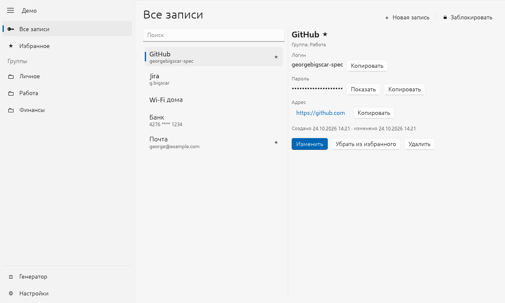
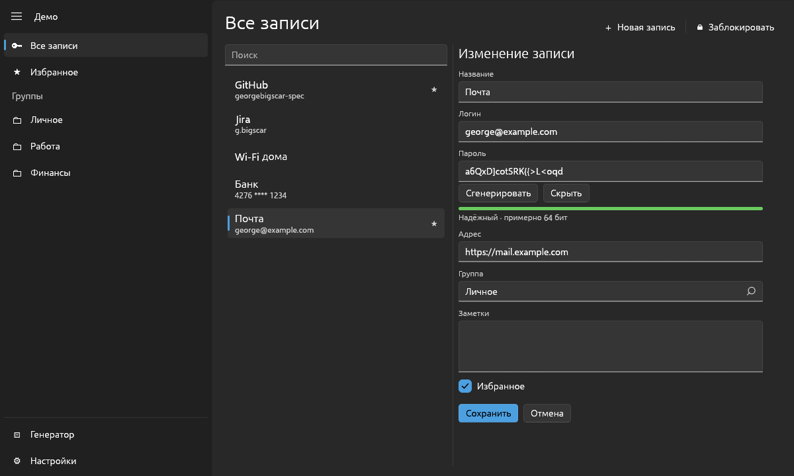

# KeeChest

Локальный менеджер паролей для рабочего стола на Rust. Интерфейс в стиле
Fluent Design построен на [fluent_egui](https://github.com/georgebigscar-spec/fluent_egui).
Никаких облаков и аккаунтов: все пароли лежат в одном зашифрованном файле на
вашем компьютере.





## Возможности

- Хранилище в одном файле `.kchest`, зашифрованном ключом из мастер-пароля.
- Записи: название, логин, пароль, адрес, группа, заметки, избранное.
- История паролей: при смене пароля старый сохраняется (последние 10).
- Поиск по названию, логину, адресу и группе; навигация по группам и избранному.
- Генератор паролей (длина, наборы символов, без похожих символов) и оценка
  надёжности через [zxcvbn](https://github.com/shssoichiro/zxcvbn-rs).
- Копирование в буфер обмена с автоочисткой (по умолчанию через 20 с) и
  пометкой для менеджеров буфера «не сохранять в истории».
- Автоблокировка после бездействия (по умолчанию 5 мин) и при сворачивании,
  блокировка вручную по Ctrl+L.
- Смена мастер-пароля и стоимости Argon2 с перешифровкой файла.
- Светлая и тёмная темы.

Горячие клавиши: Ctrl+N новая запись, Ctrl+S сохранить в редакторе,
Esc отменить правку, Ctrl+L заблокировать.

## Запуск

```sh
cargo run --release -p keechest
```

Попробовать на готовых данных (мастер-пароль `demo-password`):

```sh
cargo run -p keechest-core --example demo_vault -- demo.kchest
cargo run --release -p keechest   # «Другое хранилище…» → demo.kchest
```

На Linux для окна нужны libxkbcommon-x11 и драйверы OpenGL/Vulkan, которые
обычно уже стоят в настольной системе.

## Безопасность

| Что | Как |
| --- | --- |
| Ключ из мастер-пароля | Argon2id v1.3, по умолчанию 256 МиБ, 3 прохода, 4 потока; соль 32 байта, своя у каждого хранилища |
| Шифрование | XChaCha20-Poly1305, новый случайный 24-байтный nonce при каждом сохранении |
| Целостность | Весь заголовок (версия, параметры Argon2, соль, nonce) входит в AAD: подмена любого байта файла обнаруживается |
| Размер | Содержимое дополняется до кратного 1 КиБ, чтобы размер файла не выдавал число записей |
| Запись на диск | Временный файл с правами 0600, fsync, атомарное переименование; предыдущая версия остаётся в `*.kchest.bak` (тоже зашифрована; после смены мастер-пароля перешифровывается и она) |
| Память | Ключ, мастер-пароль и все поля записей затираются при освобождении (`zeroize`); буфер для JSON выделяется один раз нужного размера, чтобы открытый текст не оставался в старых аллокациях |
| Процесс | Отключены core dump; на Linux `PR_SET_DUMPABLE=0` не даёт другим процессам пользователя читать память через ptrace |
| Блокировка | Расшифрованные данные и ключ удаляются из памяти, состояние текстовых полей egui (в нём бывают копии введённого текста) сбрасывается |
| Защита от «бомб» | Параметры Argon2 из файла проверяются на разумные пределы до вычисления ключа |

Формат файла описан в [`crates/keechest-core/src/format.rs`](crates/keechest-core/src/format.rs).

Чего KeeChest не делает (пока): не защищает от вредоносной программы,
которая уже работает под вашим пользователем (кейлоггер, чтение экрана), и не
закрепляет память от выгрузки в swap. Поля ввода egui при редактировании
могут перевыделять строки, и старые буферы не затираются; эти копии живут
только до блокировки. Хранилище не рассчитано на одновременную работу из двух
запущенных копий программы.

Если забыть мастер-пароль, восстановить данные невозможно. Делайте резервные
копии файла `.kchest`: он зашифрован, его можно хранить где угодно.

## Устройство

| Путь | Что |
| --- | --- |
| `crates/keechest-core` | Формат файла, криптография, модель данных, генератор и оценка паролей. Без UI, с тестами. |
| `crates/keechest` | Приложение на eframe и fluent_egui. |

```sh
cargo test --workspace
```

Настройки (не секретные: последние файлы, тема, тайм-ауты, параметры
генератора) хранятся в `config.json` в каталоге настроек ОС, например
`~/.config/keechest/` на Linux.

## Лицензия

BSD-3-Clause, см. [LICENSE](LICENSE).
